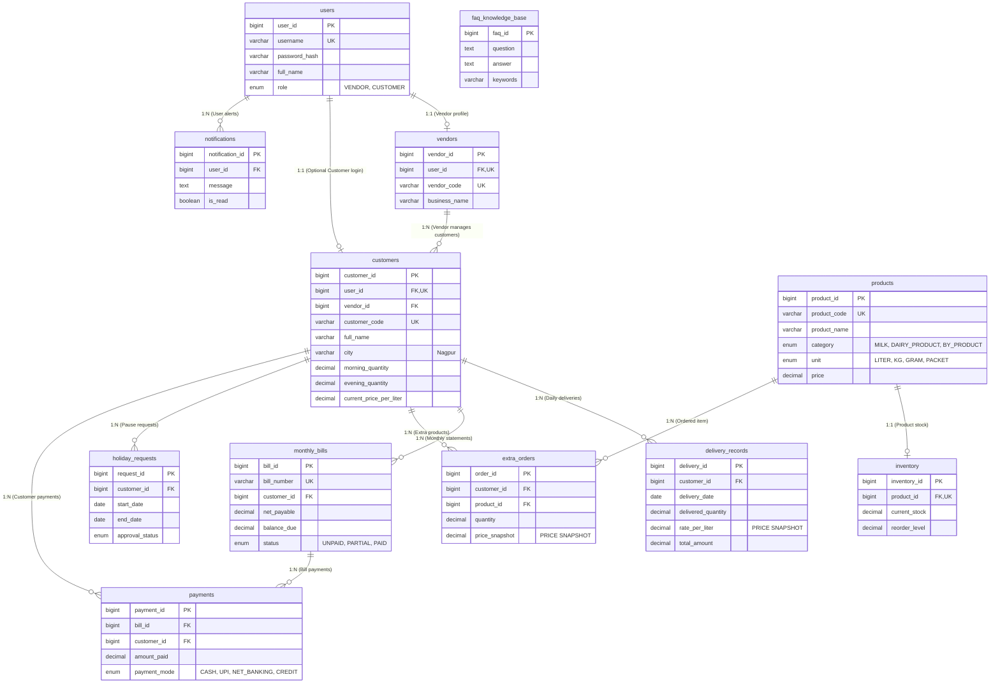

# Smart Dairy Management System
## Phase 2: Database Layer, Domain Models & DAO Interface Specification
**Revised Baseline (ProductUnit Standardization, Nagpur Sample Data & Mandatory Development Rules)**

---

### Document Overview
- **Project Name**: Smart Dairy Management System
- **Phase**: Phase 2 (Database Schema, Entity Models & DAO Interfaces)
- **Database Engine**: MySQL 8.0+ (3NF Normalized, InnoDB Engine)
- **Target Java Version**: Java 17 LTS
- **Sample Data Location**: Nagpur, Maharashtra (10 Delivery Zones)

---

## 1. Complete Database Architecture & ER Diagram

The database architecture is designed according to **Third Normal Form (3NF)** principles to eliminate data redundancy, enforce foreign key relational integrity, and guarantee zero-anomaly operations.

### 1.1 Entity-Relationship (ER) Diagram

---

## 2. Product Unit Standardization (`ProductUnit` Enum)

To enforce strict typing and data integrity across the system, product units are standardized via the `ProductUnit` enum:

- `LITER`: Liquid volumes (Fresh Cow Milk, Fresh Buffalo Milk)
- `KG`: Solid mass quantities (Fresh Malai Paneer, Set Thick Curd, Pure Cow Ghee)
- `GRAM`: Small mass products (Fresh Salted Butter)
- `PACKET`: Packaged goods (Processed Cheese Block)

The `Product` Java model entity uses `ProductUnit` instead of a plain String, and the MySQL database schema enforces `unit ENUM('LITER', 'KG', 'GRAM', 'PACKET') NOT NULL`.

---

## 3. Nagpur Sample Customer Data (10 Zones)

All sample customer data in `docs/database_schema.sql` is configured for **Nagpur, Maharashtra**, covering 10 distinct residential and commercial delivery zones:

| Customer Code | Customer Name | Area / Zone (Nagpur) | Pincode | Latitude | Longitude |
| :--- | :--- | :--- | :--- | :--- | :--- |
| `CUST-1001` | Rahul Verma | Dharampeth | 440010 | 21.1415 | 79.0634 |
| `CUST-1002` | Sunita Deshmukh | Pratap Nagar | 440022 | 21.1195 | 79.0558 |
| `CUST-1003` | Vikram Joshi | Manish Nagar | 440015 | 21.0875 | 79.0765 |
| `CUST-1004` | Mahesh Patil | Sadar | 440001 | 21.1610 | 79.0805 |
| `CUST-1005` | Anita Shinde | Trimurti Nagar | 440022 | 21.1167 | 79.0435 |
| `CUST-1006` | Sanjay Kulkarni | Nandanvan | 440009 | 21.1350 | 79.1215 |
| `CUST-1007` | Priya Nair | Wardha Road | 440015 | 21.0965 | 79.0712 |
| `CUST-1008` | Amit Shah | Hingna Road | 440016 | 21.1120 | 79.0185 |
| `CUST-1009` | Pooja Mehta | Bajaj Nagar | 440010 | 21.1275 | 79.0650 |
| `CUST-1010` | Rajesh Pawar | Ramdaspeth | 440010 | 21.1355 | 79.0740 |

---

## 4. MANDATORY DEVELOPMENT RULES FOR ALL FUTURE PHASES

The following rules are mandatory guidelines for all subsequent development phases (Phase 3 through Phase 7):

1. **Input Validation Integrity**:
   - Never skip input validations.
   - Every Service method MUST validate all input parameters before invoking the DAO layer.
2. **Strict Layer Separation**:
   - Keep ALL business logic inside the Service layer ONLY (`com.agrodairy.management.service.impl`).
   - DAO classes MUST ONLY communicate with the database (`com.agrodairy.management.dao.impl`).
   - Controllers MUST ONLY handle UI events and delegate work to the Service layer (`com.agrodairy.management.controller`).
   - NEVER place business logic inside Controllers.
3. **Database & Query Safety**:
   - NEVER write SQL queries inside Controllers or Service classes. All SQL statements must reside within DAO classes.
   - ALWAYS use `PreparedStatement` with parameterized placeholders (`?`) for database operations to prevent SQL injection.
4. **Code Quality & Architecture Enforcement**:
   - Follow clean code principles, DRY (Don't Repeat Yourself), and robust exception handling using custom runtime exceptions.
   - Reuse existing classes, DTOs, and utility helpers whenever possible.
   - NEVER redesign the package structure, database schema, or core MVC architecture in future phases.

---

## 5. Java Domain Entities Summary (`com.agrodairy.management.model`)

All 12 Java model classes follow strict JavaBean conventions:

| Model Class | Mapped Table | Description |
| :--- | :--- | :--- |
| `UserLogin.java` & `User.java` | `users` | User credentials & security roles |
| `Vendor.java` | `vendors` | Vendor business details |
| `Customer.java` | `customers` | Customer profiles & Nagpur geo-coordinates |
| `Product.java` | `products` | Product catalog with `ProductUnit` enum |
| `Inventory.java` | `inventory` | Stock levels & reorder alerts |
| `DeliveryRecord.java` | `delivery_records` | Daily shift logs with price snapshotting |
| `MonthlyBill.java` | `monthly_bills` | Monthly balance summaries & ledger totals |
| `Payment.java` | `payments` | Customer payment receipts |
| `ExtraOrder.java` | `extra_orders` | Extra orders with price snapshotting |
| `HolidayRequest.java` | `holiday_requests` | Vacation pause requests & approval status |
| `Notification.java` | `notifications` | System alerts & customer notifications |
| `FAQKnowledgeBase.java` | `faq_knowledge_base` | Local FAQ repository for offline search |

---

## 6. DAO Interfaces Summary (`com.agrodairy.management.dao`)

1. `UserLoginDAO.java` / `UserDAO.java`: User authentication & lookup queries.
2. `VendorDAO.java`: Vendor profile operations.
3. `CustomerDAO.java`: Customer CRUD, area filtering, & status updates.
4. `ProductDAO.java`: Product catalog queries.
5. `InventoryDAO.java`: Stock level updates & low-stock alerts.
6. `DeliveryRecordDAO.java` / `DeliveryDAO.java`: Batch delivery marking & historical monthly queries.
7. `MonthlyBillDAO.java` / `BillingDAO.java`: Monthly bill compilation & payment ledger updates.
8. `PaymentDAO.java`: Payment transaction logging.
9. `ExtraOrderDAO.java`: Extra order processing.
10. `HolidayRequestDAO.java` / `HolidayDAO.java`: Holiday pause approvals & date overlap checks.
11. `NotificationDAO.java`: User notification delivery & read tracking.
12. `FAQKnowledgeBaseDAO.java` / `FAQDAO.java`: Offline FAQ keyword search queries.

---
**End of Phase 2 Specification Document (Revised Baseline)**
